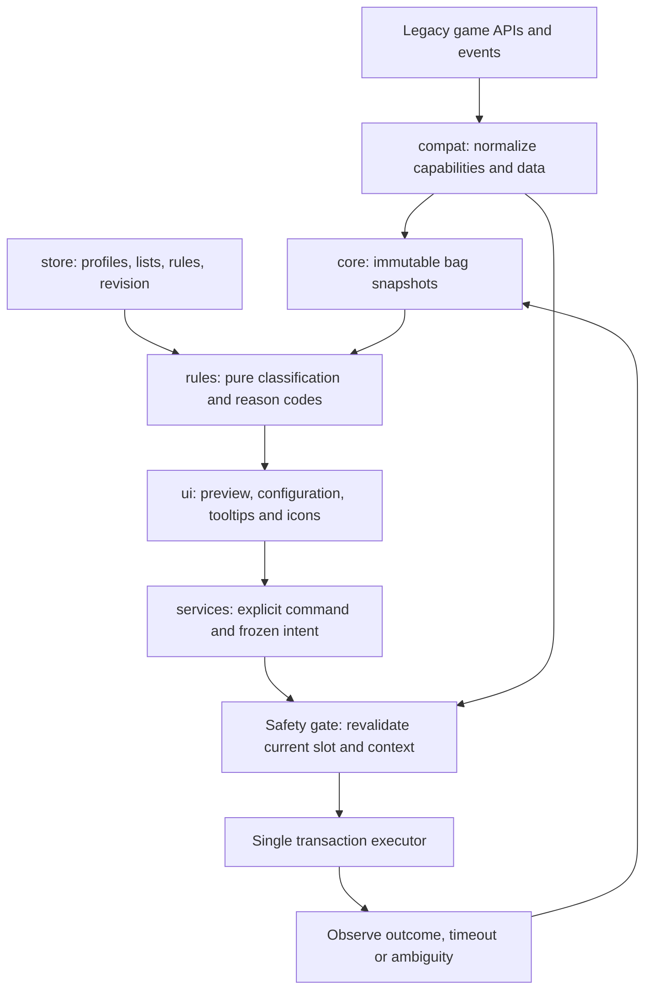

# Proposed architecture

Status: phases 1 and 2 are implemented. Phase 3 adds the pure evaluator and
read-only preview; the upstream Waffle layout engine is pinned for the phase 6
UI migration. Transaction design remains simulation-only; no inventory operation
is authorized or connected to live APIs.

## Boundaries and flow

Only `src/services` transaction executor can request mutating API methods from
`src/compat`; rules, UI, cache, callbacks and tooltips cannot. Read and write
adapter methods must be separate and injectable. The mock adapter records calls
but never delegates them to the real game.

| Directory | Future responsibility |
| --- | --- |
| src/compat | Target guard, tuple normalization, events, item metadata, equipment sets, merchant and read/write API adapters |
| src/core | Bootstrap, event bus, cancellable OnUpdate scheduler, generation-based bag cache and diagnostics |
| src/store | Defaults, deep copies, profiles, validated lists, migrations and revision counter |
| src/rules | Pure predicates, deterministic order, scopes, reason codes and custom declarative rule groups |
| src/services | Preview, sell state machine, single-stack destruction, repair, outcome evidence and loot-opening intents |
| src/ui | Legacy widgets, configuration, junk/loot lists, import/export, merchant button, minimap, tooltip and bag adapters |
| locales | Localization keys and fallback; no English-only item classification |
| libs | Empty until reviewed dependencies are pinned |
| tests | Lua 5.1 harness, pure tests, legacy API fixtures, adversarial transaction scenarios |
| tools | Offline validation and later reproducible packaging |

## Data contracts (planned)
- `ItemSnapshot`: bag (0..4 only), slot, itemId, full link, count, quality,
  unitVendorPrice, itemLevel, equipLoc, itemClass/subclass, locked, quest,
  bound, refundable, inEquipmentSet and bagGeneration. Properties with missing
  evidence are `unknown`, not false. Do not keep mutable adapter tables.
- `Decision`: action SELL/DESTROY, result KEEP/JUNK/UNKNOWN, stable reasonCode,
  ruleId, settingsRevision and bagGeneration. Localized text is a view concern.
- `Intent`: action, snapshot fingerprint (bag/slot/id/link/count), generation,
  settings revision, merchant generation if relevant, explicit user action token
  and optional confirmation token. A fingerprint reduces races but is not a
  per-item GUID; identical instances cannot always be distinguished in 3.3.5a.
  Invalidate on any relevant bag generation change rather than guessing.
- `Outcome`: ATTEMPTED, OBSERVED, FAILED or AMBIGUOUS with observed deltas. Never
  infer a completed sale solely because an item moved from its old slot.

## SavedVariables proposal
Account-wide `DejunkWotLKDB` holds `schemaVersion`, `global`, `profiles`,
`characterProfiles`, `nextProfileId`. Character keys combine explicit realm and
character name with an unambiguous separator; no realm normalization. No claim
of sharing across separate WoW accounts/installations. Each profile owns options,
lists and rule groups. Global options own UI preferences and global lists.
Active profile is looked up for the logged-in character, not one mutable global
selection for everyone. `Default` is always present and cannot be deleted or
renamed. Deleting another profile reassigns its characters to Default.

Global and profile lists are maps keyed by positive integer item IDs. Import
accepts a bounded plain-text set of decimal IDs, deduplicates, validates, previews
changes and never executes code. Uncached IDs may stay in lists while item
eligibility remains unknown. Profiles support create, duplicate, switch, rename,
reset and delete with confirmation for configuration loss. Rules and shared
profile edits increment settingsRevision and invalidate pending intents.

Migrations validate types/bounds and operate on a copy; preserve a recovery copy
before migration. Future schema versions enter read-only recovery mode rather
than overwriting data. No automatic upstream SavedVariables import in v1; a
future explicit importer needs its own fixture-driven design.

## Rule composition
The compatibility target follows the pinned upstream filter order: above-level
and above-price exclusions; profile exclusions, profile inclusions, global
exclusions, global inclusions; profile safety/options; quality and below-level/
price includes; equipment-type filters. There is no generalized ALL/ANY custom
rule language. Legacy saved custom rules are ignored by classification and
retained only as old serialized data pending a safe schema migration.

## Planned load order and UI
Future TOC: target metadata and SavedVariables; audited optional libraries;
namespace/bootstrap; locale; compatibility and constants; scheduler/events;
store/migrations; cache; pure rules; services; widgets/screens; integrations;
commands/bindings; login activation. Avoid file-scope work that reads uninitialized
SavedVariables. Register startup on ADDON_LOADED for our addon and activate bag
reads after PLAYER_LOGIN. Validate the real TOC file graph in Phase 1.

Configuration screens: Profile Options, Global Options, four searchable Lists,
Custom Rules, Profiles, Keybindings, and diagnostics/help. Separate junk preview,
lootable items and list import/export windows. Each action displays eligibility
and a reason; disabled actions ignore clicks. Defaults show preview without
automatic selling/repair. Key capture, close/Escape, focus, scrolling and resize
must work in legacy widgets and respect combat restrictions. UI art initially
uses game texture paths. Default bags are the first overlay integration; add-on
bag adapters are versioned opt-ins after dedicated validation.
